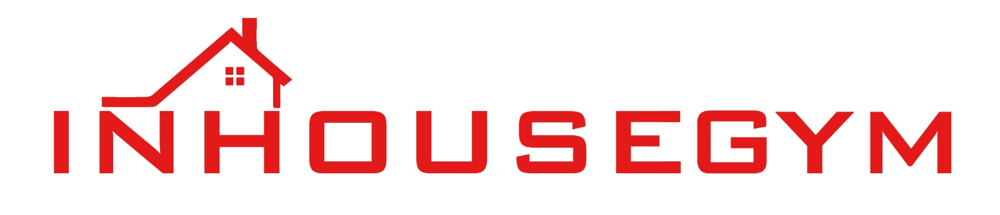

# INHOUSEGYM — Gym Equipment Rental Platform

  

# INHOUSEGYM — Gym Equipment Rental Platform

**Train Anywhere. Rent Premium Gym Equipment.**

INHOUSEGYM is a web platform for renting premium gym equipment for home workouts. Customers browse equipment, choose a monthly rental plan and get it delivered home — and the admin manages everything from a dashboard that stays updated on every device.

**Live Website:** https://inhousegym.giitsolutions.com/

## ✨ Features

**For Customers**
- Equipment catalog — Treadmills, Cross Trainers & Exercise Bikes with monthly rental prices
- Filter by category and treadmill weight capacity
- Popular Equipments section
- Product detail pages, cart & checkout (Cash on Delivery)
- User accounts with **My Rentals** to track rentals
- Live discount offers from the admin

**For Admin**
- Dashboard with stock stats (equipments, categories, brands)
- Add / edit / delete equipment, mark items as Popular
- Create category-wise offers with date range
- View rentals and registered users
- **Cross-device sync** — a change on one device shows on all devices via the backend API

## 🛠 Tech Stack

| Part | Technology |
|---|---|
| Frontend | React 18 + Vite 5 |
| Backend | Node.js + Express |
| Database | MongoDB Atlas |
| Emails | EmailJS |
| Hosting | Render (backend) |

**URL:** https://inhousegym.giitsolutions.com/

## 🚀 How to Run

git clone https://github.com/giitsolutions/inhousegym.git

cd inhousegym

npm install

npm run dev

Open http://localhost:5173 — for phone access on the same Wi-Fi, run: npm run dev -- --host

## 📁 Project Structure

- public/assets/ — Images & logo
- src/main.jsx — Storefront + cart + checkout + admin dashboard
- src/styles.css — All styling (responsive)
- index.html
- package.json

Admin dashboard is at /admin (login protected).

## 👩‍💻 Author

**GI IT Solutions** — https://github.com/giitsolutions
